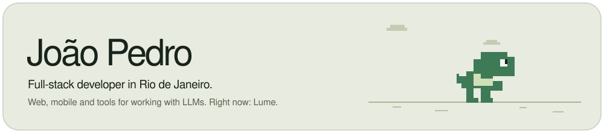
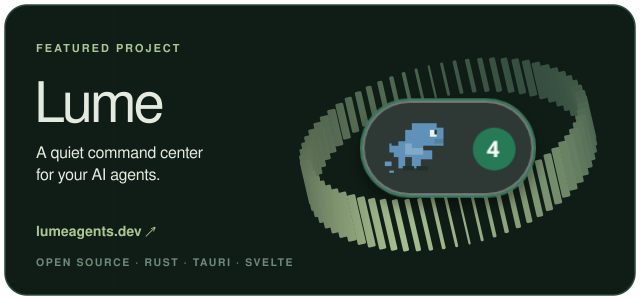

&nbsp;

**Also building**

- [**Lume Relay**](https://github.com/Lume-agents/lume-relay) &nbsp;·&nbsp; a blind, end-to-end encrypted relay for Lume Remote (AGPL-3.0)
- [**Invicto**](https://playinvicto.pages.dev) &nbsp;·&nbsp; a historic football draft you can play in the browser

**Stack**

**Backend** &nbsp; C# · .NET · Java · Python · Rust 
**Frontend** &nbsp; Svelte · Angular · React · TypeScript 
**Mobile** &nbsp; Flutter · Kotlin 
**Data & cloud** &nbsp; PostgreSQL · SQL Server · Docker · AWS

&nbsp;

Rio de Janeiro, Brazil &nbsp;·&nbsp; <a href="https://www.linkedin.com/in/joaotulerr/">LinkedIn</a>
