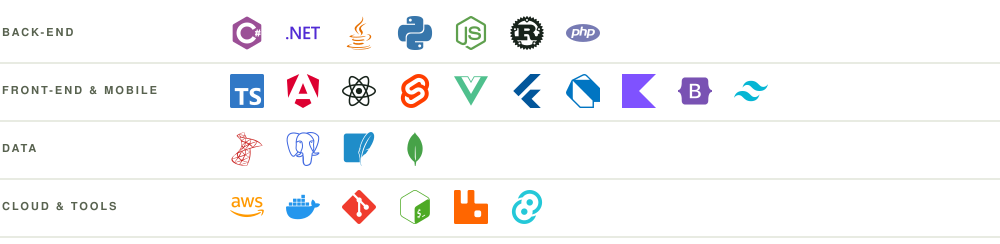
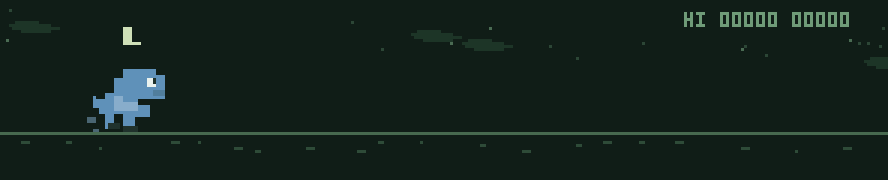

<picture>
  <source media="(prefers-color-scheme: dark)" srcset="assets/header-dark.svg" />
  
</picture>

### Stack

<picture>
  <source media="(prefers-color-scheme: dark)" srcset="assets/stack-dark.svg" />
  
</picture>

### Projects

<a href="https://lumeagents.dev"><picture>
  <source media="(prefers-color-scheme: dark)" srcset="assets/project-lume-dark.svg" />
  
</picture></a>
<a href="https://playinvicto.pages.dev"><picture>
  <source media="(prefers-color-scheme: dark)" srcset="assets/project-invicto-dark.svg" />
  
</picture></a>

Lume &nbsp;·&nbsp; [Website](https://lumeagents.dev) &nbsp;·&nbsp; [Download](https://github.com/Lume-agents/Lume/releases/latest) &nbsp;·&nbsp; [Source](https://github.com/Lume-agents/Lume) &nbsp;·&nbsp; [Relay](https://github.com/Lume-agents/lume-relay) &nbsp;·&nbsp; 

[LinkedIn](https://www.linkedin.com/in/joaotulerr/)

&nbsp;

